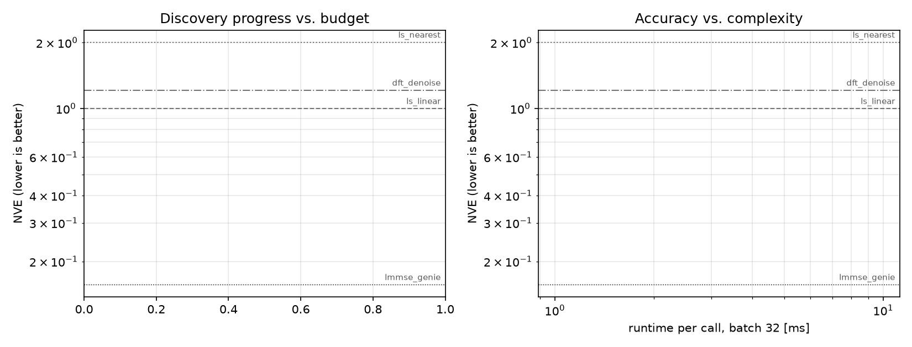

# Run report: `run-qwen1.5b`

- Task: `ofdm_channel_estimation`
- Worker model: `Qwen2.5-Coder-1.5B-Instruct`, orchestrator: `Qwen2.5-Coder-1.5B-Instruct`
- Spend: $0.0000 of $1.00 in 5 LLM calls, 12.6 min
- Candidates: 4 evaluated, 0 succeeded, 4 failed
- Stopped because: search completed

## Reference estimators

| estimator | dev NVE | held-out test NVE |
|---|---|---|
| ls_nearest | 2.0090 | 1.9997 |
| ls_linear | 1.0000 | 1.0000 |
| dft_denoise | 1.2126 | 1.1889 |
| lmmse_genie | 0.1569 | 0.1632 |

## Best discovered candidates (held-out re-evaluation)

| candidate | idea | dev NVE | test NVE | runtime [ms] |
|---|---|---|---|---|
