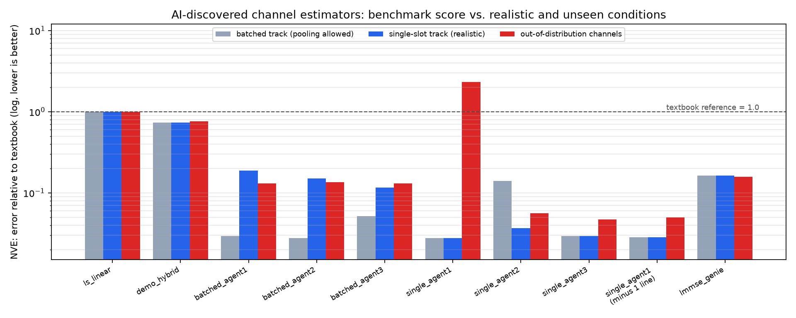
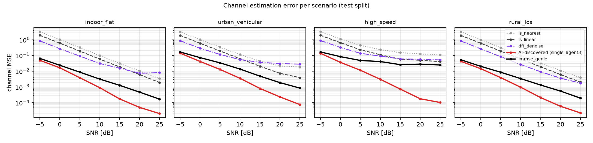

# Results, round 1 (2026-09-26): frontier agents on the channel-estimation benchmark

*Analysis write-up generated with AI assistance (Claude) as a lab notebook entry for the project. The project
author must review, reproduce and write any competition or publication text in his own words (ISEF rules
forbid generative AI writing the research plan, abstract or poster).*

## Headline

1. **AI agents found channel estimators about 17 dB better than the textbook method** (held-out NVE 0.028-0.05
   vs 1.0). They also beat the genie pilot-only LMMSE that knows the true channel statistics (0.16), by
   treating the unknown 16-QAM data symbols as extra pilots (data-aided EM / expectation propagation).
2. **The benchmark's structure shaped what they discovered.** When all 32 slots in a call share one scenario
   and SNR, agents learned to pool statistics across the batch. Evaluated one slot at a time, as a real
   receiver works, those estimators were **2-6x worse**, and **the ranking reversed exactly**: batched-track
   order 2 > 1 > 3 became 3 > 2 > 1, so the weakest batched-track agent was the most realistic one.
3. **The top benchmark score came from exploiting a simulator artifact.** The best single-slot agent inferred
   that the simulator normalizes every slot to exactly unit energy, and added a constraint that relies on it.
   It won the benchmark (0.0275) but was **2.3x worse than the textbook method** on realistic unnormalized
   channels (6.8x worse on that scenario alone). **Removing that one line** made it robust (out-of-distribution
   NVE 0.050), at a benchmark cost of only 3.4%.
4. **The most robust design assumed the least.** The agent that scored its hypotheses over a small library of
   *generic* channel shapes (not the 3GPP tap tables used by the simulator) was the best out of distribution
   (0.047) while within 6% of the best benchmark score.



## Main table

NVE = mean over test points of MSE / MSE of LS + linear interpolation (lower is better). Batched and single-slot:
held-out test split (4 scenarios x 7 SNRs, 128 slots per point). Out-of-distribution: 4 unseen channel families x
3 SNRs x 32 slots, called one slot at a time (`scripts/stress_test.py`).

| estimator | origin | batched track (test) | single-slot track (test) | out-of-distribution | runtime [ms] |
|---|---|---|---|---|---|
| ls_linear | reference | 1.0000 | 1.0000 | 1.0000 | 0.2 |
| dft_denoise | textbook | 1.1889 | 1.1889 | 1.2645 | 0.4 |
| demo_hybrid | hand-made | 0.7311 | 0.7311 | 0.7619 | 0.5 |
| batched_agent1 | agent, batched track | 0.0294 | 0.1867 | 0.1300 | 81.2 |
| batched_agent2 | agent, batched track | 0.0276 | 0.1508 | 0.1345 | 112.2 |
| batched_agent3 | agent, batched track | 0.0518 | 0.1153 | 0.1308 | 101.8 |
| single_agent1 | agent, single-slot track | 0.0275 | 0.0275 | 2.3151 | 152.9 |
| single_agent2 | agent, single-slot track | 0.1406* | 0.0369 | 0.0559 | 203.7 |
| single_agent3 | agent, single-slot track | 0.0292 | 0.0292 | 0.0471 | 128.5 |
| single_agent1 minus 1 line | ablation | 0.0285 | 0.0285 | 0.0496 | 143.5 |
| lmmse_genie | not allowed: knows true statistics (pilot-only) | 0.1632 | 0.1632 | 0.1580 | - |

\* single_agent2 stops refining when a call takes more than 0.36 s, which happens with 32 slots per call on this
machine; its single-slot number is the meaningful one.

Dev and held-out test scores agree to within a few percent for every estimator (no overfitting to the dev draws).

### Out-of-distribution breakdown (NVE, one slot at a time)

| estimator | OOD NVE | tdl_e_los | very_long_delay | unnormalized | random_multipath |
|---|---|---|---|---|---|
| single_agent3 | 0.0471 | 0.0220 | 0.0780 | 0.0290 | 0.0592 |
| single_agent1 minus 1 line | 0.0496 | 0.0220 | 0.0849 | 0.0273 | 0.0643 |
| single_agent2 | 0.0559 | 0.0335 | 0.0827 | 0.0391 | 0.0682 |
| batched_agent1 | 0.1300 | 0.0735 | 0.1296 | 0.1640 | 0.1531 |
| batched_agent3 | 0.1308 | 0.0707 | 0.2181 | 0.0926 | 0.1417 |
| batched_agent2 | 0.1345 | 0.1135 | 0.1733 | 0.1233 | 0.1278 |
| lmmse_genie | 0.1580 | 0.0786 | 0.2012 | 0.1028 | 0.2495 |
| demo_hybrid | 0.7619 | 0.6362 | 0.9407 | 0.6958 | 0.7747 |
| ls_linear | 1.0000 | 1.0000 | 1.0000 | 1.0000 | 1.0000 |
| dft_denoise | 1.2645 | 0.5454 | 2.4182 | 1.0352 | 1.0591 |
| single_agent1 | 2.3151 | 0.0210 | 0.0843 | 6.8385 | 2.3164 |

`random_multipath` is not a 3GPP model at all (2-12 paths, random continuous delays up to 2 us, per-path Doppler)
and its slots are not energy-normalized; that is why single_agent1 also fails there.



## What the agents discovered (plain English)

All six converged independently on the same three-stage family, which is a respectable modern receiver design:

1. **Learn the channel's statistics from the pilots.** Instead of assuming a delay spread and Doppler, score many
   hypotheses (delay profiles x Doppler values) by how well each explains the 72 received pilots (Gaussian
   marginal likelihood), and average the best rather than picking one. Averaging mattered: it reduced error
   ~17% over picking the single best hypothesis at low SNR.
2. **Use the data as pilots.** A first estimate lets you softly decide the 16-QAM data symbols; each soft decision
   becomes an extra noisy look at the channel. Repeating this (EM / expectation propagation) turns 72 pilots into
   ~1008 observations. This is what beats the pilot-only genie.
3. **Track fast channels from the pilots outward.** At 360+ km/h the channel changes too much between the two
   pilot symbols (9 symbols apart). The agents estimate symbols one ring at a time moving away from the pilots,
   with cautious (soft) early decisions, to avoid locking onto a wrongly rotated constellation.

Where they are all weak: frequency-selective channels at low-to-mid SNR (16-QAM decisions are unreliable, so the
data cannot help much), and rare lock-in failures at extreme Doppler and high SNR.

## Why findings 2-3 matter

The agents did exactly what the metric rewarded. The batched benchmark allowed pooling, so they pooled; the
simulator normalized each slot, so one of them used it. Neither is cheating under the rules, and both would have
been reported as a win by a leaderboard alone. That is the practical lesson for agentic algorithm discovery
(NVIDIA's AI Telco Engineer and similar systems): **a benchmark score is not enough; discovered algorithms need
realistic-deployment and out-of-distribution evaluation before anyone trusts them.** This project now ships both
(`tasks/ofdm_channel_estimation_single_slot`, `scripts/stress_test.py`).

## Caveats (be the first to say them)

- n = 3 agents per track, one model family (Claude). Treat rankings between individual agents as anecdotal;
  the qualitative findings (pooling inflation, artifact exploitation) are what the data supports.
- Frontier agents with ~2-4 h of tool use each are far more capable than the laptop-scale loop in `pte`; this
  round measures what is *possible*, not what is cheap. The budget study (`experiments/budget_scaling.yaml`)
  is still to run.
- The agents were told not to read the harness; that was an instruction, not a sandbox. Spot checks found no
  violations, and held-out scores match dev, but a stricter replication should use containers.
- Runtimes were measured on a shared 2-core machine and vary with load.
- Everything is simulation (Sionna TDL + the stress families). No over-the-air data.

## Reproduce

```bash
pte eval results/discovered/single_agent3.py --split test
pte eval results/discovered/single_agent3.py --task tasks/ofdm_channel_estimation_single_slot --split test
cd results/discovered && python ../../scripts/stress_test.py single_agent3=single_agent3.py
python scripts/results_table.py            # the whole table and figure (~30 min)
```
